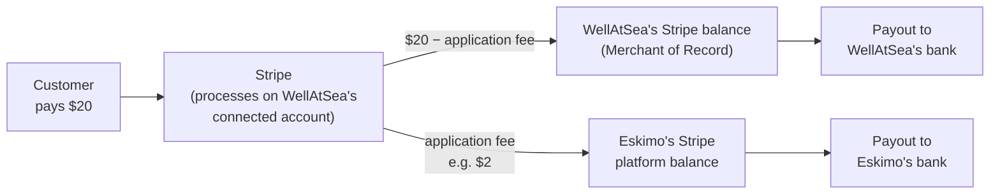
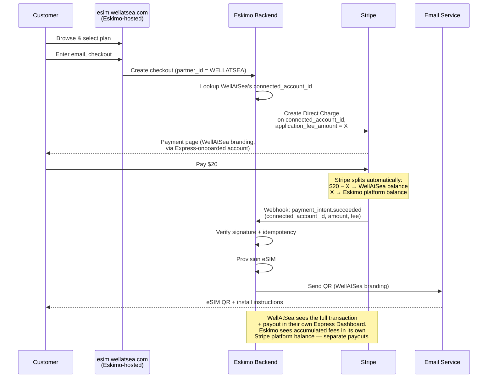

# WellAtSea Payment Flow — Stripe Connect Direct Charge + Application Fee

> **Prepared by:** Nhu Huynh | **Date:** 2026-08-13
> **Model confirmed:** Direct Charge + Express Dashboard (Hoang/Low Soon Chew), settlement via **Application Fee** (not Eskimo credit).

---

## 1. Money split — the core concept

**In plain terms:** one charge, automatically split by Stripe at the moment of payment. WellAtSea never has to manually send Eskimo money — Stripe carves out Eskimo's cut before it even lands in WellAtSea's balance.

---

## 2. Full technical flow

---

## 3. Key points this resolves

- **No manual key handover** — Eskimo's backend uses its own platform Stripe key + WellAtSea's `connected_account_id` (obtained once via the Connect onboarding link). Nothing sensitive changes hands between WellAtSea and Eskimo directly.
- **No secure-channel problem** — superseded; Stripe's OAuth-based Connect onboarding replaces the "send us your secret key" step entirely.
- **Statement branding** — Direct Charge means WellAtSea is Merchant of Record; customer's bank statement shows WellAtSea's name, not Eskimo's.
- **Trade-off accepted:** WellAtSea's retail price must stay above the application fee amount (e.g. can't sell below Eskimo's cut) — team decided this is acceptable, prioritizing simpler onboarding over maximum pricing flexibility.

---

> **Supersedes:** the manual-key model in [Guide_StripeSetup_WellAtSea.md](Guide_StripeSetup_WellAtSea.md) and Appendix A of [Presentation_WhiteLabel_WellAtSea.md](Presentation_WhiteLabel_WellAtSea.md) — both need rewriting to reflect the Connect onboarding-link flow instead of manual account/key creation. See [[project_wellatsea_whitelabel]].
